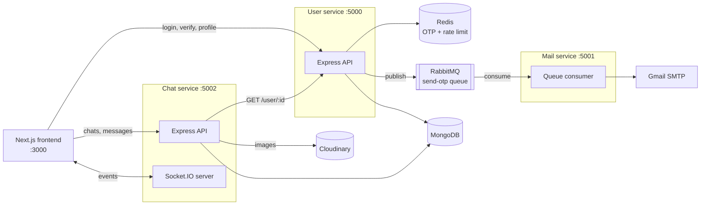

<h1 align="center">Velox Messaging</h1>

<p align="center">
  Real-time chat built as event-driven Node.js microservices: passwordless OTP login, one-to-one messaging with typing indicators, presence and read receipts, and image sharing.
</p>

<p align="center">
  <a href="https://github.com/AnveshRai09/Velox-Messaging/actions/workflows/ci.yml"></a>
  
  
  
  
</p>

---

## Highlights

- **Three independent services** (user, mail, chat), each with its own codebase, config and deployment, talking over HTTP and RabbitMQ.
- **Passwordless login:** 6-digit OTPs cached in Redis with a 5-minute TTL and a 1-minute per-email rate limit, delivered by email through a durable RabbitMQ queue.
- **Real-time chat over Socket.IO:** instant delivery, online presence, typing indicators and read receipts. Delivery takes **125 ms at p95** with 50 concurrent chats.
- **Image messages:** uploaded through Multer to Cloudinary, limited to 5 MB and 5 image formats, resized to 800×600 with auto quality.
- **Tested and observable:** 63 integration tests at 91–96% line coverage, Prometheus metrics on every service, and a CI benchmark that compares `main` with each change.

## Architecture



### Login flow

1. `POST /login` generates an OTP and stores it in Redis as `otp:<email>` (TTL 5 min). It also sets `otp:ratelimit:<email>` (TTL 1 min) to block repeat requests.
2. The OTP email is published to the durable `send-otp` queue as a persistent message, so a restart doesn't lose it.
3. The mail service consumes the message, sends the email, and acks only after SMTP accepts it.
4. `POST /verify` checks the OTP and deletes it so it can't be replayed. It creates the user on first login and returns a JWT valid for 15 days.
5. The chat service verifies the same JWT on every request with a shared secret, so it never calls the user service just to authenticate.

### Message flow

1. `POST /message` checks the sender is in the chat, then saves the message. If the receiver currently has the chat open, the message is saved as already seen.
2. The service emits `newMessage` to the chat room and to the receiver's socket. If the message was seen on arrival, it also sends `messagesSeen` back to the sender.
3. Opening a chat (`GET /message/:chatId`) marks unread messages as seen and sends a read receipt to the other person.

## Tech stack

| Layer | Technologies |
|---|---|
| Frontend | Next.js 15, React 19, Tailwind CSS 4, Socket.IO client, Axios |
| Services | Node.js, Express 5, TypeScript |
| Data | MongoDB (Mongoose), Redis |
| Messaging | RabbitMQ (AMQP), Socket.IO |
| Media and email | Cloudinary, Multer, Nodemailer |
| Testing | Vitest, Supertest, Socket.IO client |
| Observability | Prometheus (`prom-client`), autocannon load tests |
| CI/CD and deployment | GitHub Actions, Docker (RabbitMQ), AWS EC2, PM2 |

## Project structure

```
.
├── backend/
│   ├── user/            # auth, OTP, profiles                 (port 5000)
│   │   ├── src/
│   │   │   ├── app.ts           # Express app (imported by tests)
│   │   │   ├── index.ts         # connects Mongo/Redis/RabbitMQ, starts server
│   │   │   ├── config/          # db, redis, rabbitmq, metrics, token helpers
│   │   │   ├── controllers/ middleware/ model/ routes/
│   │   └── tests/
│   ├── mail/            # RabbitMQ consumer that sends OTP emails (port 5001)
│   ├── chat/            # chats, messages, uploads, Socket.IO  (port 5002)
│   └── bench/           # seed data, HTTP load test, socket latency test
├── frontend/            # Next.js app
└── .github/workflows/   # ci.yml, benchmark.yml
```

## Getting started

### Prerequisites

- Node.js 20 or newer
- MongoDB (local or Atlas), Redis (local or Upstash), RabbitMQ
- A Cloudinary account for image messages, and a Gmail app password for sending OTP emails

The quickest way to run the infrastructure locally:

```bash
docker run -d --name mongo    -p 27017:27017 mongo:7
docker run -d --name redis    -p 6379:6379   redis:7
docker run -d --name rabbitmq -p 5672:5672 -p 15672:15672 rabbitmq:3-management
```

### Environment variables

Copy each service's `.env.example` to `.env` and fill it in.

| Service | Variable | Description |
|---|---|---|
| user | `PORT` | `5000` (the frontend expects this) |
| user | `MONGO_URI` | MongoDB connection string |
| user | `REDIS_URL` | e.g. `redis://localhost:6379` |
| user, mail | `Rabbitmq_Host`, `Rabbitmq_Username`, `Rabbitmq_Password` | RabbitMQ broker (`guest`/`guest` for the local container) |
| user, chat | `JWT_SECRET` | Must be **the same** in both services |
| mail | `PORT` | e.g. `5001` |
| mail | `USER`, `PASSWORD` | Gmail address and app password |
| chat | `PORT` | `5002` (the frontend expects this) |
| chat | `MONGO_URI` | MongoDB connection string |
| chat | `USER_SERVICE` | e.g. `http://localhost:5000` |
| chat | `Cloud_Name`, `Api_Key`, `Api_Secret` | Cloudinary credentials |

### Run

In four terminals:

```bash
cd backend/user && npm install && npm run build && npm start
cd backend/mail && npm install && npm run build && npm start
cd backend/chat && npm install && npm run build && npm start
cd frontend     && npm install && npm run dev
```

Open http://localhost:3000. For development with auto-reload, use `npm run dev` in each service instead.

> The frontend's service URLs are set in `frontend/src/context/AppContext.tsx` (`user_service`, `chat_service`).

## API reference

All `/api/v1` routes except login, verify and `GET /user/:id` require `Authorization: Bearer <token>`.

### User service (`:5000`)

| Method | Route | Description |
|---|---|---|
| `POST` | `/api/v1/login` | Body `{ email }`. Sends an OTP. Returns `429` if one was sent in the last minute |
| `POST` | `/api/v1/verify` | Body `{ email, otp }`. Returns `{ user, token }` |
| `GET` | `/api/v1/me` | Current user's profile |
| `GET` | `/api/v1/user/all` | All users |
| `GET` | `/api/v1/user/:id` | One user (used by the chat service) |
| `POST` | `/api/v1/update/user` | Body `{ name }`. Returns the updated user and a fresh token |

### Chat service (`:5002`)

| Method | Route | Description |
|---|---|---|
| `POST` | `/api/v1/chat/new` | Body `{ otherUserId }`. Creates a chat, or returns the existing one |
| `GET` | `/api/v1/chat/all` | Your chats with the other user's profile, latest message and unseen count |
| `POST` | `/api/v1/message` | Body `{ chatId, text }`, or multipart with an `image` file |
| `GET` | `/api/v1/message/:chatId` | Chat history. Marks incoming messages as seen. Returns `403` if you're not in the chat |

### Socket.IO events (chat service)

Connect with `io("http://localhost:5002", { query: { userId } })`.

| Direction | Event | Payload |
|---|---|---|
| client → server | `joinChat` / `leaveChat` | `chatId` |
| client → server | `typing` / `stopTyping` | `{ chatId, userId }` |
| server → client | `getOnlineUser` | array of online user ids |
| server → client | `newMessage` | the saved message |
| server → client | `userTyping` / `userStoppedTyping` | `{ chatId, userId }` |
| server → client | `messagesSeen` | `{ chatId, seenBy, messageIds }` |

### Operational endpoints (every service)

| Route | Description |
|---|---|
| `GET /health` | `{ "status": "ok" }` |
| `GET /metrics` | Prometheus metrics |

## Testing

63 tests across three services, run in GitHub Actions against real MongoDB 7 and Redis 7 on every pull request.

| Service | Tests | Line coverage | What is covered |
|---|---|---|---|
| user | 30 | 94% | OTP issue and verify, Redis TTLs, rate limiting, OTP replay, JWT middleware (missing, forged, expired tokens), profile updates, queue publishing |
| chat | 27 | 91% | Chat creation and dedupe, access control, text and image messages, upload limits, unseen counts, user-service fallback, Socket.IO presence, typing, delivery and read receipts |
| mail | 6 | 96% | Email sending, ack only on success, malformed messages, broker failures |

RabbitMQ publishing and Cloudinary are mocked at the module boundary, so tests need no external accounts. Multer's real size limit and file filter still run.

```bash
# needs MongoDB on :27017 and Redis on :6379
# override with MONGO_TEST_URI / REDIS_TEST_URL
cd backend/chat
npm test                 # run once
npm run test:coverage    # with coverage report
```

## Observability

Every service exposes Prometheus metrics at `/metrics`, along with default Node.js process metrics (CPU, memory, event-loop lag, GC).

| Metric | Service | Meaning |
|---|---|---|
| `http_requests_total{method,route,status}` | user, chat | Requests per route pattern and status code |
| `http_request_duration_seconds{method,route,status}` | user, chat | Latency histogram per route |
| `otp_requests_total{outcome}` | user | OTPs sent vs. rate-limited |
| `otp_emails_total{outcome}` | mail | OTP emails sent vs. failed |
| `messages_sent_total{type}` | chat | Messages saved, text vs. image |
| `socket_online_users` | chat | Users currently connected |
| `socket_events_total{event}` | chat | `typing`, `stopTyping`, `joinChat`, `leaveChat` |

Routes are labelled by pattern (e.g. `/api/v1/user/:id`), not by raw URL, so the number of label values stays small.

## Performance

`backend/bench` seeds 100 users, 50 chats and 10,000 messages. It then load-tests the services with autocannon (50 connections, 20 s per scenario) and measures Socket.IO delivery latency. The [Benchmark workflow](.github/workflows/benchmark.yml) runs everything on a GitHub-hosted runner against MongoDB 7, Redis 7 and RabbitMQ 3. It runs once for `main` and once for the change, so the results can be compared directly.

The results below show the effect of adding MongoDB indexes on `messages(chatId, seen)`, `messages(chatId, createdAt)` and `chats(users)`:

| Scenario | Req/s before → after | p50 ms before → after | p99 ms before → after |
|---|---|---|---|
| `GET /chat/all` (chat list with unseen counts) | 312 → **580** | 152 → **81** | 424 → **126** |
| `GET /message/:chatId` (200-message history) | 79 → **118** | 599 → **407** | 1402 → **745** |
| `POST /message` (write + socket emit) | 567 → 552 | 86 → 88 | 133 → 122 |
| `GET /user/:id` (MongoDB read) | 1797 → 1784 | 26 → 26 | 47 → 49 |
| `GET /me` (JWT verification only) | 3248 → 3174 | 14 → 14 | 24 → 27 |

**Socket.IO delivery** (HTTP send to the receiver's `newMessage` event, 50 concurrent sender/receiver pairs, 1,000 messages): p50 95 ms, p95 125 ms, p99 158 ms.

The "after" code also includes the metrics middleware on every request. Scenarios the indexes don't touch stayed within about 2%, which bounds both the metrics overhead and run-to-run noise. Each number is from a single run, and absolute values depend on the runner.

To run the benchmark yourself:

```bash
cd backend/bench && npm install
USERS=100 MESSAGES_PER_CHAT=200 node seed.mjs    # seed first, then start the user and chat services
node http-load.mjs && node socket-latency.mjs
```

## Security

- OTPs are single-use, expire after 5 minutes, and are rate-limited to one per minute per email.
- JWTs are signed with a shared secret and expire after 15 days. Forged, expired and malformed tokens are rejected, and each case is tested.
- The chat service checks that you are in a chat before you can read it or send to it (`403` otherwise).
- Uploads accept images only, up to 5 MB, and are stored on Cloudinary, not on the server.
- Secrets are read from `.env` files, which are git-ignored. Each service has a `.env.example` listing the variables it needs.

## Roadmap

- [ ] Authenticate Socket.IO connections with the JWT instead of a client-supplied `userId`
- [ ] Paginate message history (the slowest endpoint in the benchmark)
- [ ] Retry failed OTP emails with a limit and a dead-letter queue
- [ ] Return `404` for unknown users from `GET /user/:id`
- [ ] Move frontend service URLs into environment variables
- [ ] Group chats

## Author

**Anvesh Rai** · [GitHub](https://github.com/AnveshRai09) · [LinkedIn](https://www.linkedin.com/in/anvesh-rai-502890255/)
